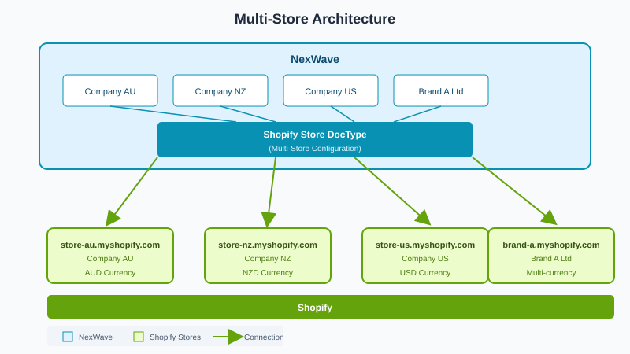
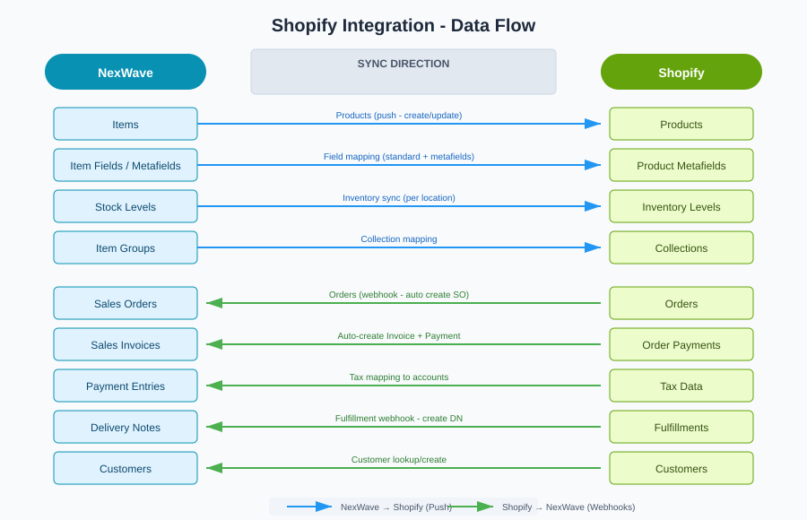

# ERPNext Shopify Connector

Multi-store Shopify connector for ERPNext, designed to connect multiple Shopify stores to a single ERPNext instance with multi-company support. Built and maintained by [HighFlyer](https://highflyerglobal.com/).

> Works with any ERPNext v15+ instance. No additional dependencies beyond ERPNext.

## Key Features

### Multi-Store, Multi-Company
Connect multiple Shopify stores to one ERPNext instance, each mapped to a separate company for proper accounting separation.

### Real-Time Order Sync
Webhook-based order ingestion with HMAC validation. Orders are automatically routed to the correct company based on store configuration. Supports automatic submission, invoicing, and payment entry creation for paid orders.

### Fulfillment Sync
Listens to Shopify fulfillment webhooks and automatically creates Delivery Notes with tracking information. Handles partial fulfillments and prevents duplicates.

Uses standard ERPNext Delivery Notes by default. Other apps can register a generic [fulfillment adapter](docs/developer-guide.md#fulfillment-adapters) to supply delivery items for their own workflows. The connector owns submission, shipping, duplicate prevention and transaction rollback.

New order imports retain Shopify line IDs for exact source-row resolution. Run the normal site migration when upgrading to add the hidden line-ID field.

### Product and Inventory Push
Sync items from ERPNext to Shopify with configurable field mapping (standard fields and metafields). Push stock levels from ERPNext warehouses to Shopify locations with multi-location support.

For active Product Bundles, stock sync calculates complete kit quantities from the available component stock in each mapped warehouse, after the store's reservation deductions. Repeated component rows are added together. All components must be enabled stock items with positive quantities in their stock units.

Non-stock items without a valid active bundle are skipped with a warning, leaving their Shopify quantities unchanged. A valid kit with an unavailable component publishes zero. Changed Bins scans also recalculate mapped bundles when their components change. These rules apply to inventory publishing; delivery handling is unchanged.

Failed scheduled inventory runs respect the store's sync interval. The last attempt time is separate from the successful stock scan cutoff, so a failed attempt does not skip pending stock changes. When Shopify rejects an inventory ID, the connector checks the exact mapped variants once, updates safe cached IDs, and retries unacknowledged healthy targets. Missing variants stay available for mapping review; the connector does not choose replacement SKUs or disable links.

### Import Item Images from Shopify

Use **Import Item Images from Shopify** on an enabled Shopify Store to fill blank primary images on its mapped Items. Existing images are preserved. The import uses the mapped variant image, or the first product image when the variant has none. Conflicting image sources or invalid mappings stop the import with an error on the Store.

The import runs in the long queue in bounded chunks and saves progress after each completed Item. Use the same button to resume a failed run after correcting its cause. A killed worker can be resumed after its 11-minute recovery lease expires. Starting another import after completion scans again for newly mapped Items and missing images. This action is separate from **Enable Image Sync**, which sends images to Shopify.

Run the normal site migration before using these changes to add the attempt time and image import checkpoint fields. Image imports require write permission on the Store and each affected Item.

### Configurable Tax Handling
- "On Net Total" approach for clean, efficient tax calculation
- Automatic zero-rated item detection with item tax template overrides
- Multi-region support (NZ 15% GST, AU 10% GST, and others)
- Shipping tax handling (as line item or separate tax row)
- Automatic rounding adjustments for Shopify/ERPNext total matching

### Collection Mapping
Map ERPNext field values (item group, brand, etc.) to Shopify Custom Collections for automatic product categorization during sync.

### Payment Method Mapping
Map Shopify payment gateways to ERPNext Mode of Payment for accurate payment tracking.

### OAuth 2.0 and Legacy Auth
Supports modern OAuth flow (recommended for new integrations) and legacy access tokens for existing custom apps.

### SKU-Based Migration Tool
Link existing Shopify products to ERPNext items by matching SKUs. Generates a report of matched, unmatched, and conflicting items.

### Automatic SKU Linking from Orders
Each Shopify Store can enable **Auto-link Items from Orders by SKU** (off by default). After a successful order import, matching existing item codes are linked to the incoming Shopify product and variant. This does not create items or publish products. Disabled links are preserved; conflicting ownership is logged for manual review.

Newly linked stock items are marked **Inventory Sync Pending** on their store row. If inventory sync is enabled, a background update is queued after the order and reservations commit. Both Full Inventory and Changed Bins runs retry pending links, including links whose stock has not changed. Pending clears only after all required variants and locations update successfully. Mapping non-stock items does not queue inventory updates.

Run the normal site migration to add these fields. Enabling this setting does not backfill existing orders or products; use **Fetch Products & Map by SKU** to review existing mapping gaps.

### Item Eligibility Filters
Control which items sync to which stores using manual overrides or automatic filter rules (e.g., "if field X has value, sync to store Y").

## Data Flow

## Documentation

- [Shopify Integration Overview](https://docs.nexwaveapp.com/s/docs/doc/shopify-integration-L1ofBu1m6e)
- [Shopify Connector Setup Guide](https://docs.nexwaveapp.com/s/docs/doc/shopify-connector-setup-guide-hpVraqmSVk)
- [Developer Guide](docs/developer-guide.md)

## License

GNU General Public License v3.0
